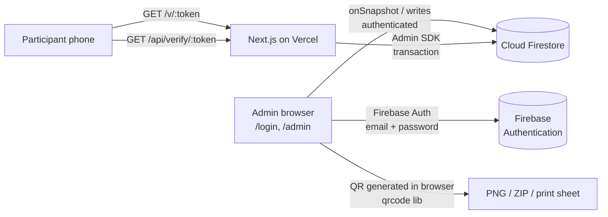
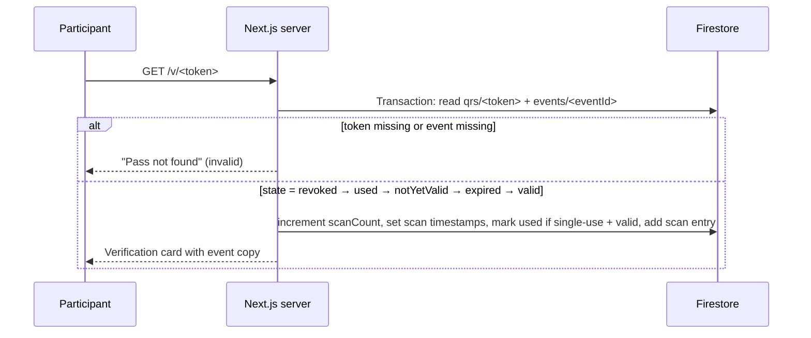

# QR Pass

**Open-source QR pass management for events.** Create an event, generate a QR code for every participant with a validity window, share the passes, and let anyone scan them on a clean public page. Every result state has copy you control per event.

[](LICENSE)
[](https://github.com/your-org/qr-pass/actions/workflows/ci.yml)
[](https://vercel.com/new/clone?repository-url=https%3A%2F%2Fgithub.com%2Fyour-org%2Fqr-pass&env=NEXT_PUBLIC_FIREBASE_API_KEY,NEXT_PUBLIC_FIREBASE_AUTH_DOMAIN,NEXT_PUBLIC_FIREBASE_PROJECT_ID,NEXT_PUBLIC_FIREBASE_STORAGE_BUCKET,NEXT_PUBLIC_FIREBASE_MESSAGING_SENDER_ID,NEXT_PUBLIC_FIREBASE_APP_ID,FIREBASE_ADMIN_PROJECT_ID,FIREBASE_ADMIN_CLIENT_EMAIL,FIREBASE_ADMIN_PRIVATE_KEY)

> Replace `your-org` in the badges and the Deploy button with your repository once you fork this project.

---

## What it is

QR Pass is a small, focused admin tool for events:

1. An administrator creates an **event** (name, dates, default validity, reusable or single-use mode).
2. They generate **QR passes** for participants — one at a time, by pasting a list of names, or by importing a CSV.
3. Each pass is a link like `https://your-app.com/v/<token>` rendered as a QR code.
4. When a participant scans it, a **server-rendered verification page** checks the pass and shows custom copy such as "Verified", "Pass expired" or "Already used".
5. Every verification is counted; the admin sees pass counts, scan counts and scan history.

There is no public sign-up. Admins sign in with a username and password.

## Features

- **Events** — create, edit, archive, delete; reusable or single-use scan mode; optional dates and location.
- **Three generation modes** — single participant, bulk paste of names, or CSV import (`name`, `email`, `label` + arbitrary extra columns saved as metadata).
- **Validity windows** — presets (event default, 1/2/7/30 days) or a custom start/end; extend a pass later.
- **Pass management** — search, filter by state, revoke/restore, edit details, delete, and bulk actions.
- **Bulk export** — download a ZIP of PNGs named after participants, or export a CSV of links and statuses.
- **Printable sheet** — `/admin/events/<id>/print` renders a grid of QR codes with names, ready for the browser's print dialog.
- **Custom verification copy** — separate title, message and tone (success / warning / error / neutral) for all six states, with a live preview.
- **Configurable visible fields** — show or hide name, email, label, valid-until, event name and any custom metadata key.
- **Server-side verification** — Firebase Admin SDK, Firestore transactions, scan history and single-use enforcement.
- **Public JSON endpoint** — `GET /api/verify/<token>` returns the same result as the page.
- **Minimal admin UI** — neutral grays, one accent, Geist, light/dark via system preference, mobile-friendly.
- **Secure by default** — Firestore rules deny everything except authenticated admins; the public page never touches Firestore directly.

## Screenshots

Screenshots coming soon — add your own to `docs/` and update this table after your first run.

| Dashboard | QR codes | Verification page |
| --- | --- | --- |
| _`docs/dashboard.png`_ | _`docs/qr-codes.png`_ | _`docs/verify.png`_ |

## Tech stack

| Layer | Choice |
| --- | --- |
| Framework | Next.js 15 (App Router, React 19, TypeScript strict) |
| Styling | Tailwind CSS v4, shadcn/ui, lucide-react |
| Auth | Firebase Authentication (email/password, username → synthetic email) |
| Database | Cloud Firestore (client SDK for the admin, Admin SDK for verification) |
| Libraries | `qrcode`, `jszip`, `papaparse`, `zod`, `react-hook-form`, `sonner`, `date-fns`, `nanoid` |
| Hosting | Vercel (single deploy, no other backend) |

## Architecture



### Verification flow



The public page and API use the Admin SDK, which bypasses security rules. Anonymous clients can never read Firestore directly.

## Firebase setup

> **Detailed walkthrough:** [docs/FIREBASE_SETUP.md](docs/FIREBASE_SETUP.md) covers credential storage (public web config vs. the secret service account), private-key formatting (escaped newlines or base64), Vercel configuration, key rotation and troubleshooting.

### 1. Create the project

1. Go to the [Firebase console](https://console.firebase.google.com/) and create a project.
2. Add a **Web app** (Project settings → General → Your apps → Web).
3. Copy the web config values — they become the `NEXT_PUBLIC_FIREBASE_*` variables.

### 2. Enable authentication

1. Authentication → Sign-in method → enable **Email/Password**.
2. Authentication → Users is where the accounts live. You do not need to create them by hand; use the provisioning script below.

### 3. Create Firestore

1. Firestore Database → Create database → **Production mode**.
2. Pick a region close to your users.

### 4. Service account for the server

1. Project settings → **Service accounts** → Generate new private key.
2. Keep the JSON file out of the repository (the `.gitignore` already excludes common names).
3. Copy `project_id`, `client_email` and `private_key` into `FIREBASE_ADMIN_PROJECT_ID`, `FIREBASE_ADMIN_CLIENT_EMAIL` and `FIREBASE_ADMIN_PRIVATE_KEY`.

The private key usually contains newlines. Keep them escaped as `\n` and wrap the value in quotes — the app converts them back. A base64-encoded key is also accepted.

### 5. Configure the app

```bash
cp .env.example .env.local
# fill in the values
```

| Variable | Scope | Purpose |
| --- | --- | --- |
| `NEXT_PUBLIC_FIREBASE_API_KEY` | client | Firebase web config |
| `NEXT_PUBLIC_FIREBASE_AUTH_DOMAIN` | client | Firebase web config |
| `NEXT_PUBLIC_FIREBASE_PROJECT_ID` | client | Firebase web config |
| `NEXT_PUBLIC_FIREBASE_STORAGE_BUCKET` | client | Firebase web config |
| `NEXT_PUBLIC_FIREBASE_MESSAGING_SENDER_ID` | client | Firebase web config |
| `NEXT_PUBLIC_FIREBASE_APP_ID` | client | Firebase web config |
| `NEXT_PUBLIC_AUTH_EMAIL_DOMAIN` | client | Domain appended to usernames. Defaults to `qrpass.local` |
| `NEXT_PUBLIC_APP_URL` | client | Absolute base URL used in QR codes, e.g. `https://qrpass.example.com`. Falls back to the browser origin |
| `NEXT_PUBLIC_HIDE_BRANDING` | client | Set to `true` to hide "Powered by QR Pass" |
| `FIREBASE_ADMIN_PROJECT_ID` | server | Service account project ID |
| `FIREBASE_ADMIN_CLIENT_EMAIL` | server | Service account email |
| `FIREBASE_ADMIN_PRIVATE_KEY` | server | Service account private key (escaped `\n` or base64) |

### 6. Deploy rules and indexes

```bash
npm install -g firebase-tools
firebase login
firebase use <your-project-id>
npm run firebase:rules
```

This deploys `firestore.rules` and `firestore.indexes.json`. The `qrs` collection needs a composite index on `eventId` + `createdAt` (included).

## Local development

```bash
npm install
cp .env.example .env.local   # fill in Firebase values
npm run create-admin -- admin "a-strong-password"
npm run dev
```

Open <http://localhost:3000>, sign in with `admin` and the password you chose.

### Create the first admin

```bash
npm run create-admin -- <username> <password>
```

- Reads `.env.local` / `.env` (admin credentials must be set).
- Converts the username to `${username}@${NEXT_PUBLIC_AUTH_EMAIL_DOMAIN}`.
- Creates the user, or resets the password if the account already exists.
- There is deliberately no sign-up UI.

You can also create users manually in the Firebase console, but the email must follow the `username@domain` pattern.

## Deploy to Vercel

1. Push the repository to GitHub.
2. Import it in Vercel (framework preset: Next.js). No build overrides are needed.
3. Add all variables from the table above to **Project → Settings → Environment Variables**.
4. Set `NEXT_PUBLIC_APP_URL` to your production URL — this is what gets embedded in every QR code.
5. Paste `FIREBASE_ADMIN_PRIVATE_KEY` exactly as it appears in the service account JSON (with `\n`). Vercel's UI may turn real newlines into escaped ones; the app handles both, and also accepts a base64 encoding.
6. Deploy the Firestore rules/indexes once from your machine (`npm run firebase:rules`).
7. Create the first production admin by running `npm run create-admin -- <username> <password>` locally with the production service account values.

> The Deploy button above is a template — update the `repository-url` once you publish your fork.

## Usage walkthrough

1. **Sign in** at `/login`.
2. **Create an event** with a default validity (for example 2 days) and choose reusable or single-use.
3. Open the event → **QR Codes** → **Generate QRs**:
   - *Single*: one participant with optional email, label and custom fields.
   - *Bulk names*: paste one name per line.
   - *CSV import*: columns `name`, `email`, `label`; any other column becomes metadata.
   - Choose a validity preset or a custom range.
4. **Share** the passes: copy a link, download the PNG, select several rows → ZIP or CSV, or open **Print sheet**.
5. **Scanning** `/v/<token>` shows the verification page. Valid, expired, not-yet-valid, revoked and used states all have their own copy.
6. Open the **Verification Page** tab to change titles/messages/tones per state and choose which participant fields are visible. The live preview updates as you type.
7. **Settings** edits the event, archives it, or deletes it (including all passes and scans).

## Data model

```
events/{eventId}
  name: string
  description?: string
  location?: string
  startsAt?: Timestamp | null
  endsAt?: Timestamp | null
  status: "active" | "archived"
  defaultValidityHours: number            // default 48
  mode: "reusable" | "single-use"
  display: {
    valid:       { title, message, tone }
    expired:     { title, message, tone }
    notYetValid: { title, message, tone }
    revoked:     { title, message, tone }
    used:        { title, message, tone }
    invalid:     { title, message, tone }
  }                                       // tone: success | warning | error | neutral
  showFields: string[]                    // ["eventName","name","label","validUntil","custom.seat"]
  createdAt: Timestamp
  createdBy: uid
  qrCount: number                         // denormalised
  scanCount: number                       // denormalised

qrs/{token}                               // document id = nanoid(24)
  eventId: string
  name: string
  email?: string
  label?: string
  meta: Record<string, string>
  validFrom: Timestamp
  validUntil: Timestamp
  status: "active" | "revoked"
  used: boolean                           // single-use
  scanCount: number
  firstScannedAt?: Timestamp
  lastScannedAt?: Timestamp
  createdAt: Timestamp

qrs/{token}/scans/{autoId}
  scannedAt: Timestamp
  result: "valid" | "expired" | "notYetValid" | "revoked" | "used"
  userAgent?: string
```

State priority: **revoked → used (single-use) → not yet valid → expired → valid**. A missing token or event is **invalid**.

## Security notes

- **Firestore rules deny everything by default.** Authenticated admins get read/write on `events`, `qrs` and scan subcollections. Anonymous clients get nothing.
- **Public verification never reads Firestore from the browser.** It runs on the server with the Admin SDK, inside a transaction.
- **Tokens are unguessable** (`nanoid(24)`, URL-safe) and are the document IDs.
- Verification responses are sent with `Cache-Control: no-store` and `X-Robots-Tag: noindex` (configured in `next.config.ts` and the page metadata).
- Admin and verify pages are marked `noindex`.
- All user input is validated with zod; service-account credentials are only read in server modules.
- Single-use passes are marked used inside the transaction, so concurrent scans cannot both succeed.

## Known limitations

- **Bot detection is user-agent based.** WhatsApp, Slack, Telegram, Discord, Twitter/X, LinkedIn, iMessage-style previews and similar crawlers are skipped: their fetches are not counted and do not consume a single-use pass. A real scan from a browser that identifies as a bot would be skipped too; a preview from a crawler with an unusual user agent could consume a pass. This is inherent to link previews.
- **Anyone with a link can verify it.** A pass is a bearer token. Do not put secrets in metadata.
- **Single admin role.** Every authenticated account can read/write everything. This is a single-tenant tool.
- **No rate limiting.** Add Vercel Firewall / rate limiting if you expose the public page broadly.
- **Denormalised counters can drift** if a client write fails mid-batch. The values are advisory, not billing-grade.
- **Real-time lists load every pass for an event.** Comfortable up to a few thousand passes per event; add pagination for larger events.
- **Bulk generation is capped at 2,000 passes per action** and Firestore batches are limited to 400 writes.
- **Deleting an event or many passes happens in the browser** and removes scan history in batches; very large collections take a while.
- **No PDF export.** The print sheet uses the browser's print-to-PDF instead.
- **Datetimes** are stored as instants and entered in the admin's local timezone. Public display uses the viewer's locale.

## Design decisions

- **Username login uses a synthetic email** (`username@NEXT_PUBLIC_AUTH_EMAIL_DOMAIN`) because Firebase Auth requires an email. No public sign-up exists; admins are provisioned with `create-admin`.
- **Admins read Firestore directly with the client SDK**, protected by rules. Verification is the only server-side data path, which keeps the public page fast and avoids exposing admin credentials.
- **The public page is fully server-rendered and dynamic** (`force-dynamic`, `no-store`) because every view is a stateful verification.
- **Bot user agents skip all writes**, not just the single-use flag, so previews don't inflate scan counters. The trade-off is documented above.
- **"Event-based" validity means the event's `defaultValidityHours`**, starting at generation time. It does not tie passes to `startsAt`/`endsAt`.
- **Archived events still verify.** Archiving only affects the dashboard's default filter and signals intent.
- **Event name is rendered small at the top** and is gated by the `eventName` entry in `showFields`; it is not duplicated as a detail row.
- **QR images are generated in the browser** with the `qrcode` library (error correction M, 1024 px) so no image storage is needed. The print sheet renders at 512 px with four concurrent jobs.
- **Bulk writes use batches of 400** (plus one counter update) to stay under Firestore's 500-operation limit.
- **Counters (`qrCount`, `scanCount`) are denormalised** with `FieldValue.increment` so the dashboard can render without aggregating thousands of documents.
- **The JSON endpoint writes scans too**, mirroring the page. It is intended for integrations, not as a side-effect-free lookup.
- **The verification card is a pure component** reused by the public page and the admin live preview.
- **Next.js is pinned to the patched 15.5.29 release** and Tailwind v4 / shadcn's current `radix-nova` registry is used.

## Project structure

```
.
├── .github/
│   ├── ISSUE_TEMPLATE/
│   └── workflows/ci.yml
├── scripts/create-admin.ts
├── src/
│   ├── app/
│   │   ├── admin/
│   │   │   ├── events/[eventId]/{page.tsx,print/page.tsx}
│   │   │   ├── events/new/page.tsx
│   │   │   ├── layout.tsx
│   │   │   └── page.tsx
│   │   ├── api/verify/[token]/route.ts
│   │   ├── login/page.tsx
│   │   ├── v/[token]/{page.tsx,loading.tsx}
│   │   ├── error.tsx, layout.tsx, not-found.tsx, page.tsx
│   │   └── globals.css
│   ├── components/
│   │   ├── auth/            AuthProvider, AuthGuard, LoginForm
│   │   ├── events/          event form, detail, tabs, print sheet
│   │   ├── layout/          admin header
│   │   ├── qr/              table, dialogs, validity picker
│   │   ├── ui/              shadcn/ui components
│   │   └── verify/          VerificationCard, VerificationPage
│   ├── lib/
│   │   ├── firebase/        client.ts, admin.ts
│   │   ├── firestore/       events.ts, qrs.ts, helpers.ts
│   │   ├── constants.ts, format.ts, qr.ts, qr-status.ts
│   │   ├── schemas.ts, validity.ts, verify.ts, verify-fields.ts
│   │   └── utils.ts
│   └── types/index.ts
├── docs/FIREBASE_SETUP.md
├── firestore.rules
├── firestore.indexes.json
├── firebase.json
├── .env.example
└── package.json
```

## Scripts

| Script | Description |
| --- | --- |
| `npm run dev` | Start the dev server |
| `npm run build` | Production build |
| `npm start` | Start the production server |
| `npm run lint` | ESLint |
| `npm run typecheck` | `tsc --noEmit` |
| `npm run create-admin -- <username> <password>` | Create or reset an admin |
| `npm run firebase:rules` | Deploy Firestore rules and indexes |

## License

[MIT](LICENSE)
